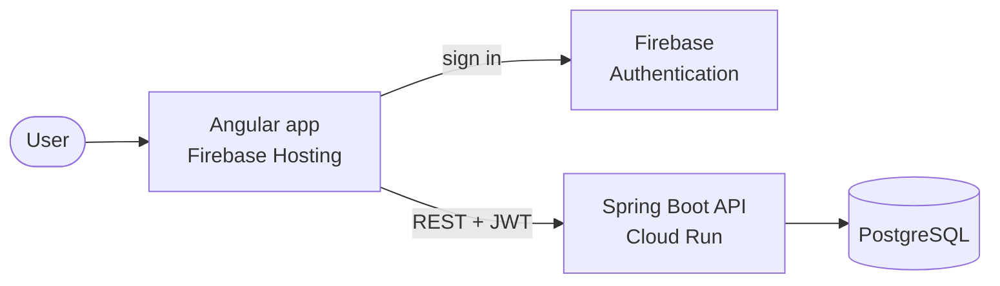

# Expense Tracker

A personal finance web app to track expenses and income, see where your money
goes, and manage savings goals. Built as an end-to-end, production-grade
learning project: from the first commit to a secure, monitored deployment on
Google Cloud.

> **Status:** In development, Phase 0 (foundation). Not usable yet.

## Why this project

1. **A real problem:** I want a clear picture of my spending and savings, and
   a simple way to share the app with friends.
2. **Production practices:** every decision follows the way professional teams
   build software: documented architecture decisions, protected branches,
   signed commits, automated tests, CI/CD, infrastructure as code, and observability.

## Planned features

**MVP**
- Sign up and sign in
- Register expenses and income
- Default categories that each user can customize
- Payment sources as labels (cash, debit card, credit card), with no bank connections
- Savings envelopes with optional goals and progress
- Monthly summary: where the money goes

**Later**
- Budgets per category with usage alerts
- Recurring expenses
- Installable app (PWA)
- Quick expense entry from the phone

## Tech stack

| Area | Technologies |
|---|---|
| Backend | Java (LTS), Spring Boot, Spring Modulith, Spring Security (OAuth2 Resource Server), Spring Data JPA, Flyway, Maven |
| Frontend | Angular, TypeScript, API client generated from OpenAPI |
| Database | PostgreSQL |
| Authentication | Firebase Authentication / Google Identity Platform |
| Cloud | Google Cloud: Cloud Run, Artifact Registry, Secret Manager, Firebase Hosting |
| Infrastructure as code | Terraform |
| CI/CD | GitHub Actions with Workload Identity Federation |
| Quality and security | JUnit 5, Testcontainers, SonarQube Cloud, CodeQL, Dependabot |
| Observability | Cloud Logging and Monitoring, OpenTelemetry, Sentry |

## Architecture

The backend is a **modular monolith**: a single deployable application split
into domain modules whose boundaries are verified by tests. Modules with real
business rules (budgets, savings, reports) use hexagonal architecture; simple
CRUD modules use plain layers.



Every architecture decision is documented as an
[Architecture Decision Record](docs/adr/README.md), including the alternatives
considered and the trade-offs accepted.

## Repository structure

```
expense-tracker/
├── backend/        # Spring Boot API (planned)
├── frontend/       # Angular app (planned)
├── infra/          # Terraform (planned)
└── docs/
    └── adr/        # Architecture Decision Records
```

## Getting started

Coming soon. Local setup will use Docker Compose to run the API and PostgreSQL.

## Development workflow

- **Branching:** trunk-based development. Short-lived branches merged into
  `main` through pull requests with squash merge. `main` is protected
  ([ADR-0018](docs/adr/0018-trunk-based-development.md)).
- **Commits:** [Conventional Commits](https://www.conventionalcommits.org/),
  signed and verified.
- **Languages:** code, commits, issues and this README in English;
  architecture decision records in Spanish
  ([ADR-0025](docs/adr/0025-language-conventions-update.md)).

## Roadmap

- [ ] **Phase 0: Foundation.** Repository, decisions, branch protection, backlog, project skeleton, first CI pipeline
- [ ] **Phase 1: MVP.** Core features running locally
- [ ] **Phase 2: First deployment.** Google Cloud, custom domain, HTTPS, staging and production
- [ ] **Phase 3: Hardening.** Observability, security reviews, load testing, performance

## License

All rights reserved. The source code is public for portfolio purposes, but no
license is granted to copy, modify or distribute it.
